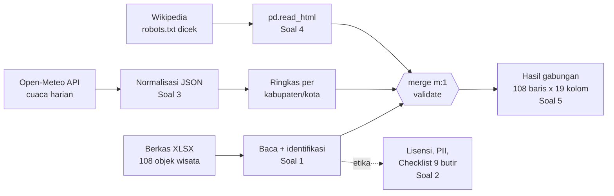

# UTS Data Acquisition & Management — Daya Tarik Wisata Bali

**Mahasiswa:** I Gusti Ngurah Dwi Andika Putra (2501010016)
**Mata kuliah:** Data Acquisition & Management, Kelas E, Informatika — INSTIKI
**Dosen:** Dr. I Gede Totok Suryawan, S.Kom., M.T.
**Ujian:** UTS Ganjil, 19 November 2026

## Ringkasan

Proyek ini mengumpulkan data **sektor pariwisata Bali** dari tiga cara akuisisi yang berbeda, lalu menggabungkannya per kabupaten/kota. Hasil akhirnya adalah tabel 108 daya tarik wisata yang masing-masing dilengkapi **kondisi cuaca wilayahnya** (suhu, hujan, angin) dan **profil kabupaten/kota** (luas, penduduk, kepadatan).

Seluruh proses dikerjakan dalam satu notebook (`.ipynb`) dengan prinsip akuisisi yang etis: lisensi diperiksa, `robots.txt` dipatuhi, setiap request memakai timeout, User-Agent berisi email kampus, dan jeda antar-request. Tidak ada API key atau token yang tertulis di notebook.

## Sumber data

| | Cara akuisisi | Sumber | Isi | Lisensi |
|---|---|---|---|---|
| (a) | **Berkas** | `dataset_wisata_cuaca_bali_2026.xlsx`, sheet `Wisata_108`; merujuk daftar daya tarik wisata Pemprov Bali di [data.go.id](https://data.go.id/dataset/dataset/sebaran-daya-tarik-wisata-di-bali) | 108 objek wisata di 9 kabupaten/kota | Tidak dicantumkan pada halaman dataset; dipakai konservatif (akademik, non-komersial, beratribusi) |
| (b) | **API** | [Open-Meteo Historical Weather API](https://open-meteo.com/en/docs/historical-weather-api) | Cuaca harian 2026 untuk 9 kabupaten/kota (2.826 baris) | CC BY 4.0 |
| (c) | **Web scraping** | Wikipedia, [List of districts in Bali](https://en.wikipedia.org/wiki/List_of_districts_in_Bali) (halaman statis) | Luas, penduduk 2020, kepadatan, jumlah kecamatan per kabupaten/kota | CC BY-SA 4.0 |

> **Catatan jujur tentang sumber (a):** berkas ini adalah kompilasi yang merujuk portal data.go.id, bukan salinan asli portal, dan statusnya belum diverifikasi ke dinas/portal resmi. Hal ini dicatat apa adanya di provenance dan di Data Ethics Checklist.

## Alur akuisisi



## Struktur repository

```
.
├── *.ipynb                       # notebook utama (semua sel sudah dijalankan)
├── README.md
├── data/
│   ├── raw/                      # data mentah, TIDAK diubah
│   │   ├── dataset_wisata_cuaca_bali_2026.xlsx
│   │   ├── openmeteo_<kabupaten>_2026-01-01_<akhir>.json   (9 berkas)
│   │   └── wikipedia_list_of_districts_in_bali.html
│   └── processed/                # hasil olahan
│       ├── cuaca_harian_bali_2026.csv
│       ├── profil_kabupaten_bali_wikipedia.csv
│       └── gabungan_wisata_cuaca_profil_bali.csv
├── metadata/
│   ├── provenance.csv            # URL, tanggal akses, lisensi, MD5 tiap sumber
│   └── gabungan_metadata.json    # metadata hasil penggabungan
├── docs/
│   ├── data_ethics_checklist.csv
│   └── data_ethics_checklist.md
└── evidence/                     # bukti robots.txt dan lisensi
```

## Hasil utama

| Ukuran | Nilai |
|---|---|
| Objek wisata | 108 (12 per kabupaten/kota, 9 kabupaten/kota) |
| Data cuaca harian | 2.826 baris (9 kabupaten/kota, 1 Januari – 11 November 2026) |
| Profil wilayah | 9 baris (hasil scraping) |
| Hasil gabungan | **108 baris × 19 kolom**, tanpa duplikasi |
| Estimasi storage 1 tahun (berkas dataset) | ± 2,0 MB (ukuran × 12 bulan + cadangan 30%) |

## Cara membaca setiap soal di notebook

| Soal | Isi | Bagian notebook |
|---|---|---|
| 1 | Baca berkas (`sheet_name`, `dtype`, `na_values`), identifikasi data, estimasi storage | *Soal 1* |
| 2 | Lisensi, PII/quasi-identifier, Data Ethics Checklist 9 butir | *Soal 2* → hasil di `docs/` |
| 3 | Akuisisi API Open-Meteo, penanganan status code dan retry, tabel ≥ 30 baris | *Soal 3* |
| 4 | Pemeriksaan `robots.txt`, scraping tabel dengan `pd.read_html` | *Soal 4* → bukti di `evidence/` |
| 5 | Merge dengan `validate`, bukti tanpa duplikasi, simpan beserta metadata | *Soal 5* → `metadata/gabungan_metadata.json` |
| — | Provenance seluruh sumber + verifikasi MD5 | *Provenance akhir* → `metadata/provenance.csv` |

## Penggabungan data

- **Kunci gabung:** `kabupaten_kota`.
- Dataset wisata **tidak memiliki tanggal kunjungan**, sehingga cuaca harian diringkas per kabupaten/kota lebih dulu (suhu rata-rata, total hujan, jumlah hari hujan, angin maksimum). Dengan begitu kunci di tabel cuaca dan profil bersifat unik dan relasinya **banyak-ke-satu (`m:1`)**.
- Pembuktian tanpa duplikasi: jumlah baris sebelum dan sesudah merge sama (108), `id_wisata` unik, baris duplikat penuh = 0, dan tidak ada baris tanpa pasangan cuaca atau profil.

### Kamus kolom hasil gabungan

| Kolom | Keterangan | Asal |
|---|---|---|
| `id_wisata`, `nama_objek_wisata` | Kode dan nama objek wisata | Berkas |
| `kabupaten_kota`, `jenis_wisata`, `jenis_normal` | Wilayah dan kategori (`jenis_normal` = kategori dengan urutan token diseragamkan) | Berkas |
| `latitude_kabupaten`, `longitude_kabupaten` | Koordinat representatif kabupaten/kota | Berkas |
| `suhu_rata2_c`, `suhu_maks_rata2_c`, `suhu_min_rata2_c` | Rata-rata suhu harian (°C) | API |
| `kelembapan_rata2_persen` | Rata-rata kelembapan relatif (%) | API |
| `hujan_total_mm`, `hari_hujan` | Total hujan (mm) dan jumlah hari dengan hujan ≥ 1 mm | API |
| `angin_maks_kmh` | Kecepatan angin maksimum (km/jam) | API |
| `jumlah_hari_cuaca` | Jumlah hari data cuaca yang diringkas | API |
| `luas_km2`, `penduduk_2020`, `kepadatan_per_km2`, `jumlah_kecamatan` | Profil wilayah | Scraping |

## Etika dan kepatuhan

- **Lisensi:** diperiksa untuk ketiga sumber (lihat tabel sumber dan `docs/data_ethics_checklist.md`).
- **robots.txt:** diperiksa sebelum scraping; hasil `can_fetch` dan salinan robots.txt disimpan di `evidence/`.
- **Request web yang sopan:** `timeout` pada setiap request, User-Agent berisi email kampus, jeda 2 detik antar-request, dan retry dengan backoff untuk error sementara (429/5xx).
- **Kredensial:** tidak ada API key/token di notebook (Open-Meteo gratis tanpa key).
- **PII:** tidak ada data pribadi; data berupa nama tempat wisata dan wilayah administratif.
- **Sumber terlarang tidak dipakai:** Booking.com, Agoda, Traveloka, tiket.com, Airbnb, Tripadvisor, Google Maps, dan media sosial.
- **Provenance:** setiap sumber tercatat di `metadata/provenance.csv` (URL, tanggal akses, lisensi, hash MD5). Notebook memverifikasi bahwa semua berkas di `data/raw` tidak berubah dengan membandingkan MD5.

## Keterbatasan data

1. Daftar 108 objek wisata adalah hasil kurasi dengan kuota seragam (12 per kabupaten/kota), **bukan sensus** seluruh daya tarik wisata Bali, sehingga tidak mewakili proporsi sebenarnya; kategori "Alam" mendominasi.
2. Koordinat bersifat representatif **kabupaten/kota**, bukan per objek, sehingga cuaca yang digabungkan adalah cuaca wilayah.
3. Cuaca berasal dari **reanalisis berbasis grid** Open-Meteo, bukan stasiun pengamatan.
4. Status objek wisata belum diverifikasi ke dinas/portal resmi.
5. Halaman dataset data.go.id mengembalikan HTTP 404 pada akses otomatis, sehingga bukti lisensi portal diambil secara manual melalui peramban.

## Cara menjalankan ulang

1. Buka notebook di Google Colab (File → Open notebook → GitHub), atau unduh dan jalankan di Jupyter.
2. Pastikan tersedia koneksi internet (Open-Meteo dan Wikipedia diakses ulang).
3. Unggah `dataset_wisata_cuaca_bali_2026.xlsx` ke `data/raw/` bila diminta oleh sel persiapan.
4. Jalankan **Runtime → Restart and run all**.
5. Dependensi: `pandas`, `numpy`, `requests`, `lxml`, `openpyxl` (sudah tersedia di Colab).

> Periode cuaca berakhir 7 hari sebelum tanggal eksekusi (data arsip memiliki jeda pemrosesan), sehingga jumlah baris cuaca dapat berbeda jika dijalankan di tanggal lain.

## Atribusi dan lisensi

- Weather data by [Open-Meteo.com](https://open-meteo.com/) — [CC BY 4.0](https://creativecommons.org/licenses/by/4.0/)
- Profil wilayah: Wikipedia, [List of districts in Bali](https://en.wikipedia.org/wiki/List_of_districts_in_Bali) — [CC BY-SA 4.0](https://creativecommons.org/licenses/by-sa/4.0/)
- Daftar objek wisata: merujuk data.go.id (Pemerintah Provinsi Bali); lisensi tidak dicantumkan pada halaman dataset.

Repository ini dibuat untuk **tujuan akademik non-komersial** (tugas UTS) dan akan dijadikan privat atau dihapus setelah penilaian semester selesai.

## Kontak

I Gusti Ngurah Dwi Andika Putra — igustingurahdwiandikaputra@instiki.ac.id
